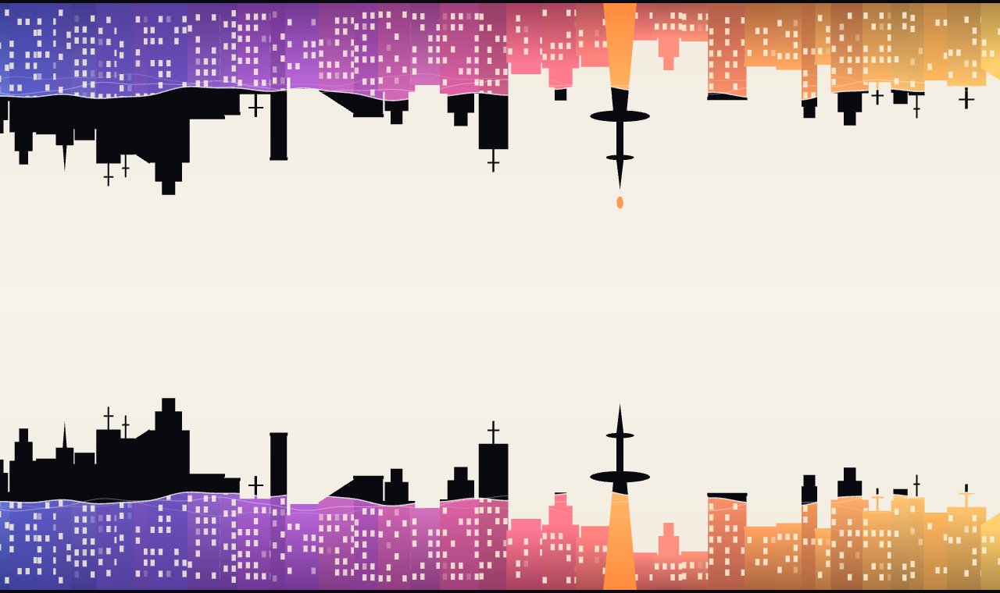
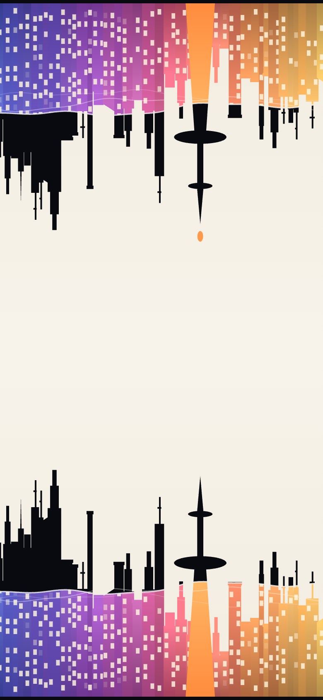

# city-lake

위에 매달린 컬러 도시에서 물방울이 하나씩 떨어져, 아래에 서 있는 검은 도시를 **3분 동안** 색으로 채우는 그림이에요.
아래 도시가 다 채워지면 물방울이 다시 올라가서, 색이 위 도시로 돌아가요. 모래시계처럼 계속 반복돼요.

버튼이나 설정 같은 도구는 없고, 화면을 그대로 감상하는 작품이에요.

| 데스크톱 | 모바일 |
| --- | --- |
|  |  |

## 동작 방식

- 위 도시는 화면 맨 위에 매달려 있고, 아래 도시는 화면 맨 아래에 서 있어요. 둘은 같은 스카이라인을 위아래로 뒤집은 모양이에요.
- 가장 높은 바늘 타워 끝에서 물방울이 하나씩 맺혀 떨어져요. 한 번에 한 방울이에요.
- 한 방향에 정확히 **180초**가 걸려요. 물방울은 90개이고, 마지막 물방울이 닿는 순간 색이 다 채워져요.
- 색이 채워지는 경계에는 출렁이는 물결선이 보여요. 위 도시는 매달린 끝에서부터 색이 빠지고, 아래 도시는 바닥에서부터 색이 차올라요.
- 다 채워지고 2초 쉰 뒤에는 물방울이 거꾸로 올라가요. 아래 도시의 색이 빠지고 위 도시가 다시 채워져요.
- 물방울 색은 도시를 칠한 노을 그라데이션(남보라, 보라, 분홍, 주황, 금빛)에서 골라요. 닿을 때 튀는 물방울은 그라데이션 전체 색이에요.

## 실행하기

빌드 과정이 없어요. 파일을 그대로 열면 돼요.

- `index.html`을 브라우저에서 열어요.
- 또는 로컬 서버로 열어요.

```bash
python3 -m http.server 8000
```

그다음 브라우저에서 `http://localhost:8000`으로 들어가요.

## GitHub Pages로 배포하기

1. 이 폴더를 저장소 루트로 올려요. `index.html`이 루트에 있어야 해요.
2. 저장소의 **Settings → Pages**로 가요.
3. **Source**를 `Deploy from a branch`로 두고, 브랜치는 `main`, 폴더는 `/ (root)`로 골라요.
4. 잠시 뒤 `https://<사용자 이름>.github.io/<저장소 이름>/` 주소에서 볼 수 있어요.

## 파일 구성

```
index.html      페이지. 캔버스 하나와 메타 정보만 있어요
style.css       화면 전체를 채우는 캔버스 스타일
script.js       도시 그리기, 물방울 일정, 애니메이션
favicon.svg     브라우저 탭 아이콘
docs/           README에 쓰는 미리보기 이미지
.nojekyll       GitHub Pages가 파일을 그대로 서비스하게 해요
```

## 값 바꾸기

`script.js` 맨 위의 상수를 바꾸면 돼요.

| 상수 | 기본값 | 의미 |
| --- | --- | --- |
| `N` | 90 | 한 방향에서 떨어지는 물방울 수 |
| `PHASE_S` | 180 | 색이 다 건너가는 데 걸리는 시간(초) |
| `PAUSE_S` | 2 | 방향이 바뀌기 전에 쉬는 시간(초) |
| `FALL_S` | 1.0 | 물방울이 두 타워 끝 사이를 날아가는 시간(초) |
| `NEEDLE_X` | 0.62 | 바늘 타워 위치(가로 비율) |
| `STOPS` | 노을 5색 | 도시와 물방울에 쓰는 색 그라데이션 |

`PHASE_S`를 바꾸면 물방울 사이 간격이 자동으로 다시 계산되고, 마지막 물방울이 닿는 순간이 항상 `PHASE_S`에 맞아요. 물방울 간격은 `PHASE_S / N`쯤이에요.

스카이라인 모양은 `makeSpecs()`의 난수 시드(`mulberry32(21)`)로 정해져요. 시드를 바꾸면 다른 도시가 나와요.

## 반응형

- 화면 크기에 맞춰 캔버스가 항상 화면 전체를 채워요. 창 크기를 바꾸거나 휴대폰을 돌리면 다시 그려요.
- 세로로 긴 화면에서는 스카이라인을 가로로 줄이지 않아요. 바늘 타워가 화면 가운데에 오도록 양옆을 잘라 보여 줘서, 건물이 가늘어지지 않고 창문도 또렷하게 보여요.
- 고해상도 화면(레티나)에서는 선명하게 그리되, 성능을 위해 해상도 배율은 2배까지만 써요.
- 노치가 있는 휴대폰에서도 `viewport-fit=cover`로 가장자리까지 채워요.

## 지원 브라우저

`Path2D`, `CanvasRenderingContext2D.ellipse`, `ResizeObserver`를 쓰는 최신 Chrome, Edge, Safari, Firefox에서 동작해요.

## 라이선스

아직 정하지 않았어요. 공개하기 전에 `LICENSE` 파일을 추가해 주세요.
